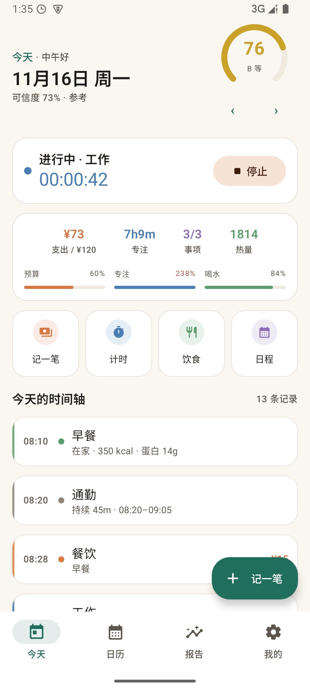
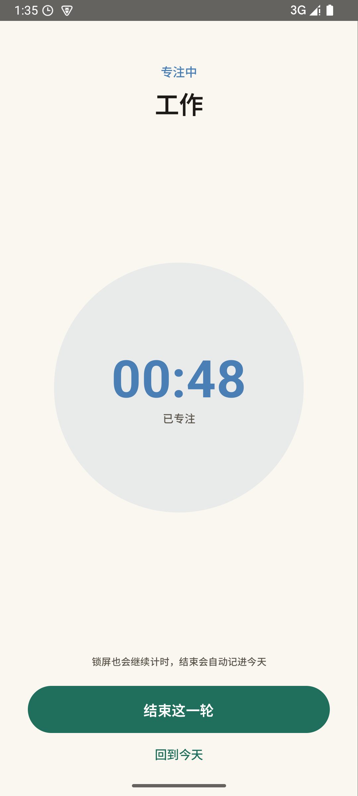
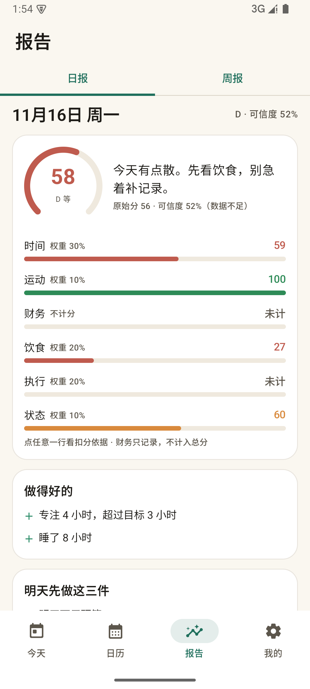
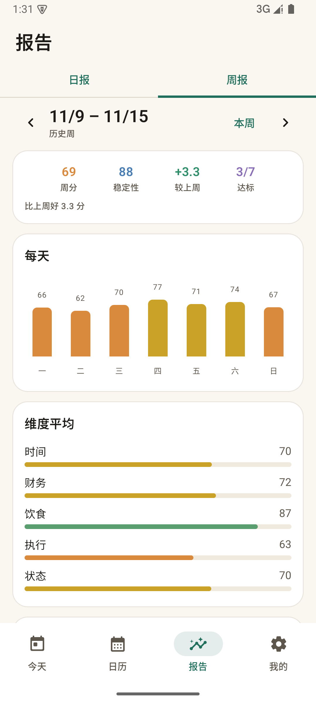
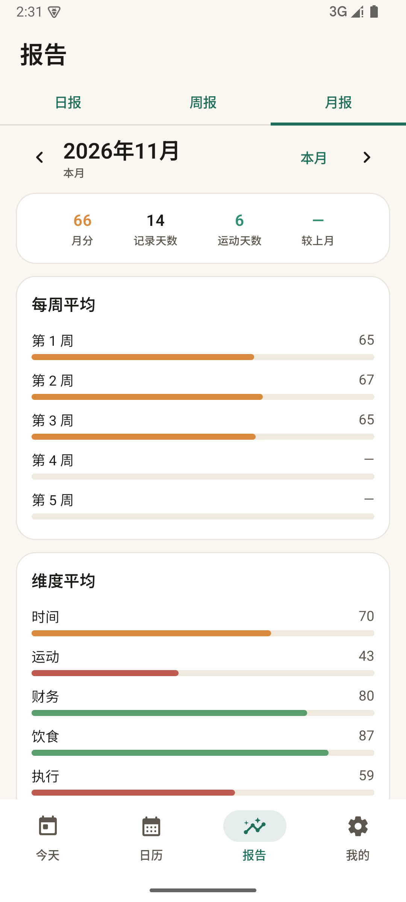
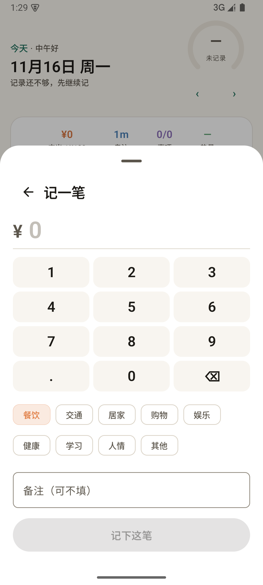
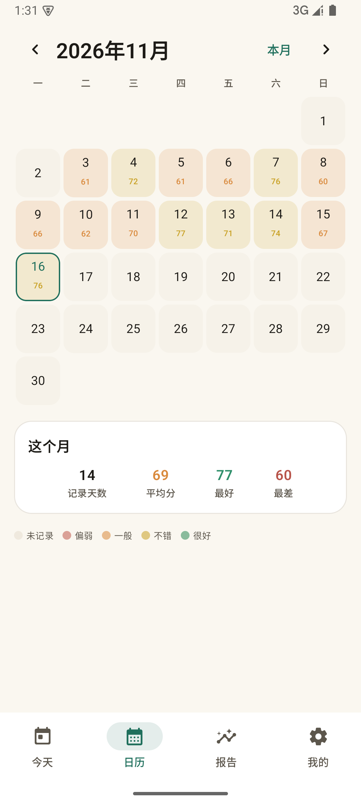

# 日计 DayLedger

> 一个完全离线的安卓个人记录 App：**记账 · 时间 · 饮食 · 日程**记在同一条时间轴上，每天自动打分复盘，周末出周报，月底出月报。

不需要账号，不需要服务器，**不申请联网权限**。


---

## 为什么做这个

市面上的 App 各管一摊：记账的不管时间，计时的不管吃饭，待办的不管你今天过得怎么样。想把一天看明白，得装四个 App、维护四套数据，最后四份都坚持不下去。

日计只做一件事：**把一天当成一条时间轴**。所有记录都是轴上的一个条目，只是字段不同。晚上它帮你回答三个问题：

- 今天时间花哪了？
- 计划的事做到了吗？
- 身体被怎么对待了？

## 截图

| 今天（时间轴 + 分数） | 计时中（常驻通知） |
|---|---|
|  |  |

| 专注页 | 日报（五维 + 扣分依据） |
|---|---|
|  |  |

| 周报 | 月报 |
|---|---|
|  |  |

| 记支出（自带数字键盘） | 日历（分数热力） |
|---|---|
|  |  |

## 功能

**记录**
- 记账：自带九宫格数字键盘、分类、备注；支持修改
- 时间：自由计时 / 番茄 25·45·60，前台服务 + 常驻通知，锁屏继续；可补记、可改起止
- 运动：跑步 / 力量 / 骑行 / 游泳 / 球类 / 瑜伽 / 走路，按形式 × 时长 × 强度计分
- 饮食：记清「吃了什么」为主体，健康标签（蔬果/蛋白/油炸/甜食/饮料/酒）判断健康度，热量可选；饮水单独记录
- 日程：计划时段、重要三件事、完成 / 放弃、超时判定
- 复盘：心情、精力、入睡起床、今天没花钱、一句话

**评分**
- 五项加权：时间 30 / 运动 10 / 饮食 20 / 执行 20 / 状态 10
- **财务只记录、不计入总分**——花多花少常是客观原因，不该影响自我评价
- 缺失数据不做 0 分处理，按已有维度归一；可信度不足时不出分
- 每个扣分点都能点开看依据，不是黑箱

**报告**
- 日报：分数、做得好 / 可以改、明天三件事、今天的账
- 周报：周分、稳定性、趋势、每天柱状、维度平均、钱 / 时间 / 饮食
- 月报：月分、每周平均、整月的钱和时间、运动天数、洞察与下月建议
- 日历：月视图分数热力，点任意一天补记

**其他**
- 提醒：日程开始前 10 分钟、每晚 22:00 复盘（只用不精确闹钟，不申请特殊权限）
- 数据：JSON 导出 / 导入、清空记录；没有云，没有账号
- 深色模式、Android 13 单色主题图标

## 评分怎么算

```
raw   = (0.30×时间 + 0.10×运动 + 0.20×饮食 + 0.20×执行 + 0.10×状态) / 0.90
conf  = 0.5×记录覆盖率 + 0.5×(时间/饮食/日程/复盘 四类齐备数/4)
final = 60 + (raw − 60) × conf
```

几条刻意的设计：

- **睡眠 7–8 小时算达标区间**，不是卡死 7.5 小时
- **没排日程不扣“结构分”**，否则不用日历的人会在时间维度被罚两次
- **运动有上限**：练两小时不会比半小时多拿分；三次 10 分钟不如一次 30 分钟
- **数据不足时分数往 60 收敛**，而不是虚高或判低

完整公式、参数和示例见 [评分与报告规则](docs/02-评分与报告规则.md)。

## 隐私

- 安装包里**没有 INTERNET 权限**，系统设置里可以核对
- 没有账号、没有埋点、没有崩溃上报
- 数据只在这台手机的本地数据库；卸载或换机前请先导出备份

## 技术栈

| 层 | 选择 |
|---|---|
| 语言 / UI | Kotlin 2.0 · Jetpack Compose · Material 3 |
| 数据 | Room + Flow、DataStore |
| 架构 | 单 Activity，纯 Kotlin 评分引擎（无 Android 依赖，可单测） |
| 后台 | 前台服务（计时）、AlarmManager（提醒）、BootReceiver（重启补排） |
| 测试 | JUnit 黄金用例 + Robolectric 数据库端到端 |
| 构建 | Gradle 8.11 · AGP 8.7 · JDK 17，纯命令行，不需要 Android Studio |
| 兼容 | Android 8.0+（minSdk 26），targetSdk 35 |

## 自己构建

环境：JDK 17 + Android SDK 35 + Gradle 8.11（Windows 上用脚本可一键装）。

```powershell
powershell -ExecutionPolicy Bypass -File scripts\bootstrap-env.ps1   # 可选：装工具链
powershell -ExecutionPolicy Bypass -File scripts\build.ps1          # 出 APK
```

产物在 `dist/`。签名配置在 `app/build.gradle.kts`，密钥放在 `keys/`（已被 `.gitignore` 忽略，**请自行备份**）。

## 项目结构

```
app/src/main/java/com/dayledger/app
├── data/        Room 表、DAO、仓库、设置、备份
├── domain/      纯 Kotlin：DayFacts、评分引擎、日报/周报/月报
├── ui/          Compose：今天 / 日历 / 报告 / 设置 + 记录面板
├── timer/       计时前台服务、提醒、开机补排
└── util/        日期与格式化
app/src/test     评分黄金用例 + Robolectric 数据库冒烟测试
docs/            产品大纲、评分规则、安装使用
```

## 下载

去 [Releases](https://github.com/zidantou87/dayledger/releases) 下载 `dayledger-*.apk`，传到手机安装即可。

首次安装会提示“未知来源”，允许一次即可（所有非商店 APK 都一样）。

## 路线图

- [x] 记账 / 时间 / 运动 / 饮食 / 日程 / 复盘
- [x] 评分、日报、周报、月报、日历
- [x] 番茄钟、常驻通知、全屏专注页
- [x] 提醒（日程 + 每晚复盘）
- [ ] 桌面小组件
- [ ] CSV 导出、自动备份
- [ ] 更细的趋势图（雷达图 / 年度回顾）

## 已知限制

- 提醒用不精确闹钟，可能晚几分钟；关机期间错过的提醒不补发
- 月末前，月报里未来的周显示为空
- 目前只有中文界面

## 许可

[MIT](LICENSE)
