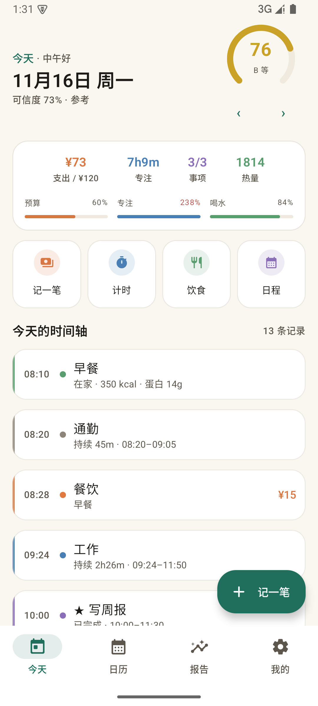

# 日计 DayLedger

个人用的离线安卓应用：记账 · 时间记录 · 饮食 · 日程，同一条时间轴，自动打分与日报/周报。

- 本地存储，不需要服务器，**不申请联网权限**
- Android 8.0+（minSdk 26）
- 当前版本：**v1.0.4**

## 装到手机上

APK：[`dist/dayledger-1.0.4.apk`](dist/dayledger-1.0.4.apk)（正式包，11.5 MB，专用签名）

步骤见 [安装与使用](docs/03-安装与使用.md)。

## 长什么样

在 Pixel 6 / Android 15 模拟器上实拍（含两周示例数据）：

| 今天（时间轴 + 分数） | 计时中（常驻通知） |
|---|---|
|  |  |

| 专注页（点进行中卡片进入） | 日报（四维计分 + 财务不计分） |
|---|---|
|  |  |

| 周报（每天 / 趋势 / 维度） | 日历（分数热力） |
|---|---|
|  |  |

其余：[快速记录](shots/02-quickadd.png) · [记支出（自带数字键盘）](shots/03-expense.png) · [记时间（番茄钟）](shots/09-time.png) · [复盘](shots/08-review.png) · [设置](shots/07-settings.png)

## 在模拟器里自己看

环境已经装好（`D:\AndroidDev` + AVD `dayledger`）：

```powershell
D:\AndroidDev\sdk\emulator\emulator.exe -avd dayledger
D:\AndroidDev\sdk\platform-tools\adb.exe install -r dist\dayledger-0.1.0-debug.apk
# 想先看有数据的样子（空库才生效）：
D:\AndroidDev\sdk\platform-tools\adb.exe shell am start -n com.dayledger.app/.MainActivity --ez demo true
```


## 文档

| 文档 | 内容 |
|---|---|
| [01-产品大纲](docs/01-产品大纲.md) | 定位、原则、页面、数据模型、技术方案、路线图 |
| [02-评分与报告规则](docs/02-评分与报告规则.md) | 五维评分公式、可信度、日报/周报模板、洞察规则 |
| [03-安装与使用](docs/03-安装与使用.md) | 安装、每日流程、备份恢复、已知限制 |

## 已经做完的（v0.1）

- [x] 今天：四类记录混排时间轴、进行中计时器、今日分数环、可信度、预算/专注/喝水进度
- [x] 记账：自带数字键盘、分类、备注；**财务只记录，不计入总分**
- [x] 时间：自由计时 / 番茄 25·45·60、前台服务常驻通知、锁屏继续、全屏专注页、补记
- [x] 运动：跑步/力量/骑行/游泳/球类/瑜伽/走路，按"形式 × 时长 × 强度"计分，单次 <10 分钟不计
- [x] 饮食：三餐/加餐、在家/外卖/外食、热量蛋白蔬菜、饮水
- [x] 日程：计划时间、重要三件事、完成/放弃、超时判定
- [x] 复盘：心情、精力、入睡起床、今天没花钱、一句话
- [x] 评分：时间/运动/饮食/执行/状态 五项加权（财务只记录不计分）、数据缺失归一、可信度收敛、扣分依据
- [x] 报告：日报、周报、月报（月分/每周平均/维度/钱/时间/运动/吃/洞察与建议）
- [x] 日历：月视图分数热力、点日期补记
- [x] 提醒：日程开始前 10 分钟、每晚 22:00 复盘（只用系统不精确闹钟，不额外要权限）
- [x] 图标：自适应图标 + Android 13 单色主题图标 + 启动画面底色
- [x] 编辑：点任意记录 → 修改（记账/时间/饮食/日程都可改，时间可调起止）
- [x] 设置：预算与目标、严格度、隐藏分数、导出/导入 JSON、清空所有记录

## 还没做（下一版可加）

- 日程到点提醒、每日复盘通知
- 桌面小组件、快捷方式
- 月报 / 年报 / CSV 导出
- 周报雷达图

## 自己构建

环境已经装好（JDK 17 + Android SDK 35 + Gradle 8.11.1，都在 `D:\AndroidDev`）：

```powershell
powershell -ExecutionPolicy Bypass -File scripts\build.ps1
```

产物：`dist/dayledger-0.1.0-debug.apk`。

## 结构

```
app/src/main/java/com/dayledger/app
├── data/        Room 表、DAO、仓库、设置、备份
├── domain/      纯 Kotlin：DayFacts、评分引擎、报告生成
├── ui/          Compose：今天/日历/报告/设置 + 快速记录/复盘面板
└── util/        日期与格式化
app/src/test     评分黄金用例 + Robolectric 数据库冒烟测试
```
